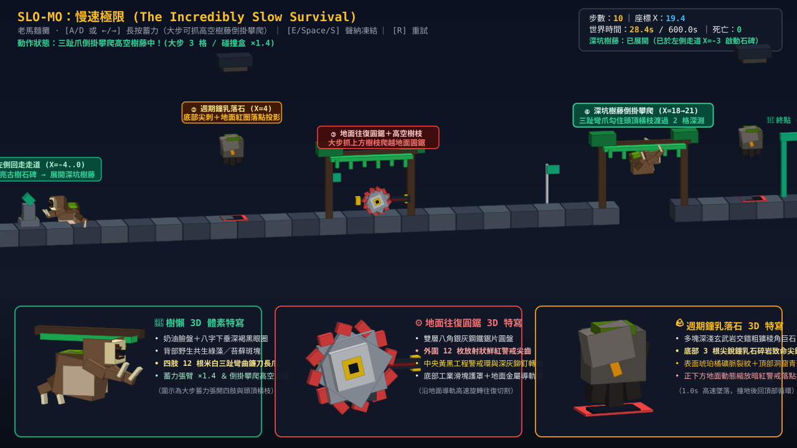
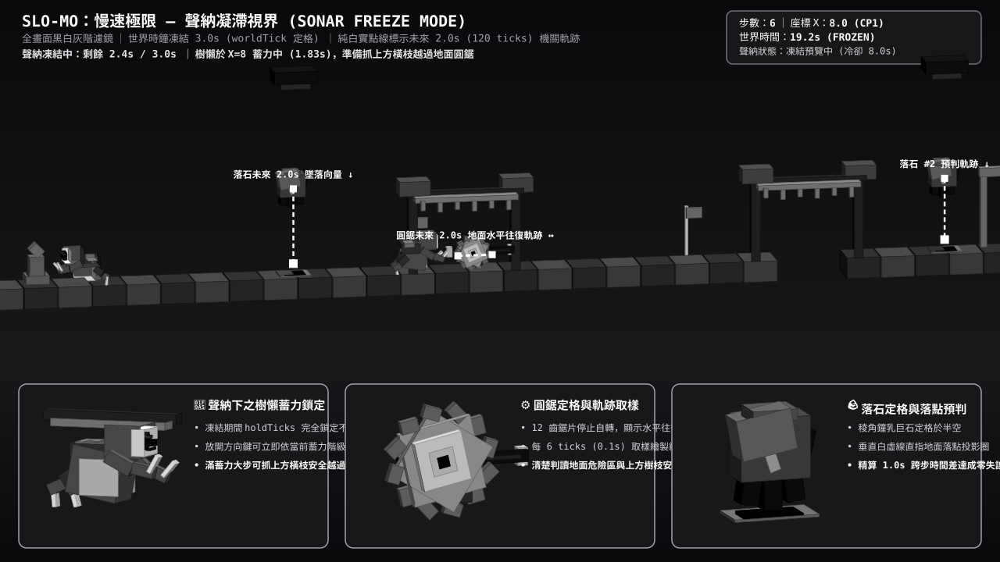

# 🦥 SLO-MO: 慢速極限 (The Incredibly Slow Survival)

> **「當全世界都比你快十倍，唯一的生存之道就是預判未來。」**  
> **【老馬麵攤製作】** — HTML5 / WebGL (Three.js) 2.5D 體素慢動作預判解謎遊戲

[](https://tonnychiulab.github.io/The-Incredibly-Slow-Survival/)
[](#%E6%9C%AC%E6%A9%9F%E9%96%8B%E7%99%BC%E8%88%87%E6%B8%AC%E8%A9%A6)
[](#%E6%8E%88%E6%AC%8A%E8%88%87%E7%B4%A0%E6%9D%90)

👉 **[點此立即在瀏覽器遊玩 (https://tonnychiulab.github.io/The-Incredibly-Slow-Survival/)](https://tonnychiulab.github.io/The-Incredibly-Slow-Survival/)**

---

## 📸 實機 3D 體素關卡與角色機關特寫 (Screenshots & 3D Voxel Anatomy)

### 1. 雙向回走解謎、高空樹藤倒掛攀爬與 3D 體素特寫（`level01`）


### 2. 聲納凝滯視界（世界時間暫停 3.0s ＋ 未來 2.0s 機關軌跡向量預覽）


---

## 🦥 角色與致命機關 3D 體素樣態設計

- **🦥 三趾樹懶（Three-Toed Sloth）**：
  - **標誌性外觀**：奶油色臉盤、**八字下垂深褐黑眼圈（淚溝斑）**、半瞇慵懶睡眼、慢活微笑嘴角，以及背毛上的**野生共生綠藻／苔蘚斑塊**。
  - **修長四肢與 12 根三趾鐮刀長爪**：前後四肢末端皆配置 3 根彎曲米白長爪（共 12 爪）。
  - **機制連動姿態**：
    - **三段蓄力張臂（`×1.0 / ×1.2 / ×1.4`）**：長按方向鍵蓄力時，前後長爪會隨蓄力比例大幅向前後張開，直觀呈現大步蓄力時水平碰撞箱擴大為 `×1.4` 倍的風險。
    - **高空樹藤倒掛攀爬（Upside-down Canopy Climb）**：在架有高空橫枝／樹藤的區段使出 3 格大步時，樹懶會**向上伸出四肢三趾彎爪勾住頭頂樹藤，以招牌「倒掛擺盪」姿態越過地面圓鋸與 2 格深淵**！
- **⚙️ 地面往復圓鋸（Reciprocating Circular Saw）**：
  - 雙層八角銀灰鋼鐵圓盤 ＋ **外圍 12 枚放射狀鮮紅警戒尖齒** ＋ 中央黃黑工程警戒環與深灰鉚釘轉軸。
  - 下方配置工業滑塊護罩與**可見的地面金屬導軌槽與止擋塊**，沿水平軌道高速自轉切割。
- **🪨 週期鐘乳落石（Periodic Falling Rock）**：
  - 由多塊深淺玄武岩交錯堆疊成不規則粗獷稜角巨石，**底部帶有 3 根尖銳鐘乳石致命尖錐**，表面嵌有琥珀橘礦脈裂紋與洞窟青苔。
  - 頂部設有洞窟碎石發射口，正下方地面繪有**隨落石高度動態縮放的暗紅警戒落點投影圈（Drop Shadow）**。

---

## 🕹️ 操作說明

| 按鍵 | 動作 | 規則說明 |
|---|---|---|
| **`→` / `D`** 或 **`←` / `A`** | **轉身 / 三段蓄力出步 / 倒掛攀爬** | • 若按反方向鍵：先執行 **0.4s 轉身**（不算步數），完成後繼續按住自動進入前搖。<br>• **`[0, 0.8s)` 放開**：取消動作，不算步數。<br>• **`[0.8s, 1.5s)` 放開**：**小步（移動 1 格）**，水平碰撞盒 `×1.0`。<br>• **`[1.5s, 2.2s)` 放開**：**中步（移動 2 格）**，水平碰撞盒放大為 `×1.2`。<br>• **`≥ 2.2s` 放開**：**大步（移動 3 格）**，水平碰撞盒放大為 `×1.4`；**若頭頂有已展開的高空樹藤橫枝，樹懶會自動伸出三趾長爪勾住樹藤倒掛攀爬通過！** |
| **`E` / `Space` / `S` / `↓`** | **啟動聲納凝滯 (Sonar)** | 凍結世界時間 `worldTick` **3.0 秒**（冷卻 **8.0 秒**，自啟動起算），畫面轉為高對比黑白並顯示所有機關未來 **2.0 秒** 的移動軌跡線。 |
| **`R`** | **立即重試 (Restart)** | 隨時重置本關回到起點。 |

---

## 🗺️ Level 01 雙向回走與攀爬關卡動線

1. **① 左側回走走道與古樹石碑（`X = -4 .. 0`）**：
   - 起點位於 `X = 0`，左方 `X = -4 .. 0` 為完整左側走道。玩家須先按住 `A / ←` **轉身往左回走至 `X = -3` 踩亮「古樹藤蔓石碑」**，使後方 `X = 18..21` 深坑頂部的高空攀爬樹藤完全展開，再轉身往右推進。
2. **② 第一道週期鐘乳落石（`X = 4`）**：
   - 觀察地面暗紅落點投影與落石節奏，抓準時間差通過並抵達 **檢查點 1（`X = 8`）**。
3. **③ 地面往復圓鋸 ＋ 高空橫枝攀爬（`X = 8 .. 11`）**：
   - `X = 9.2 .. 9.8` 地面鋪有水平往復圓鋸；若只用小步／中步走地面會直接撞上圓鋸。玩家須於 `X = 8` 蓄滿 **2.2 秒大步（3 格）**，讓樹懶**勾住上方 `X = 8..11` 的高空老樹枝倒掛爬越圓鋸上方**，再推進至 **檢查點 2（`X = 16`）**。
4. **④ 2 格深坑斷崖 ＋ 高空樹藤倒掛渡坑（`X = 18 .. 21`）**：
   - `X = 19..20` 為無底深坑。確認左側石碑已啟動使頭頂樹藤展開後，於斷崖邊 `X = 18` 蓄滿 **2.2 秒大步（3 格）**，樹懶會**用三趾鐮刀長爪勾住高空樹藤倒掛擺盪渡過深坑**，安全落回對岸 `X = 21`（若未啟動石碑或只跨 1～2 格則會抓空墜落）。
5. **⑤ 終點前高速鐘乳落石（`X = 23`）與終點拱門（`X = 25`）**：
   - 開啟聲納預判短週期落石軌跡，精準跨步衝線通關！

---

## 🏗️ 確定性模擬架構與專案文件

所有設計與審查文件統一整理於 [`docs/`](docs/) 目錄：
- [`docs/design.md`](docs/design.md)：遊戲系統設計規格書與詳細實作計畫（SDD）
- [`docs/contract.md`](docs/contract.md)：品牌與介面契約規範
- [`docs/level-format.md`](docs/level-format.md)：關卡 JSON 格式規範（含 `vineSwitches` 與 `canopyBranches`）
- [`docs/assets.md`](docs/assets.md)：素材與字型登記清單

---

## 💻 本機開發與測試

```bash
# 安裝依賴
npm install

# 啟動開發伺服器 (http://localhost:5173)
npm run dev

# 執行 11 項單元、3D 體素結構、輸入映射與確定性重播測試 (Vitest)
npm test

# 建置生產環境靜態檔案 (dist/)
npm run build
```

---

## 📄 授權

- **MIT License**（【老馬麵攤製作】）
